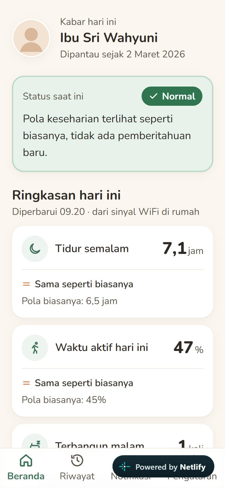
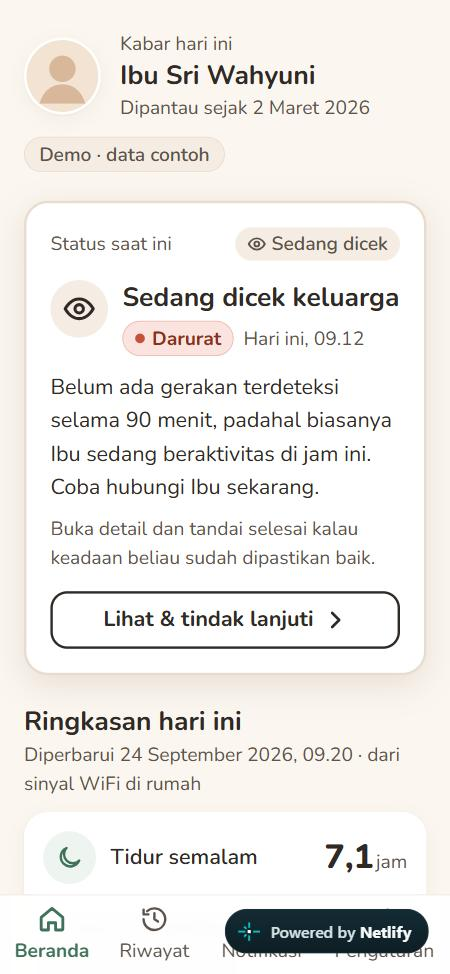
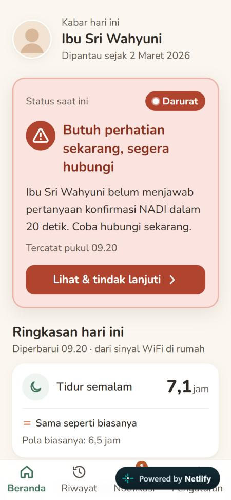
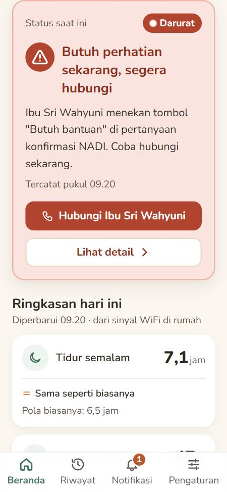
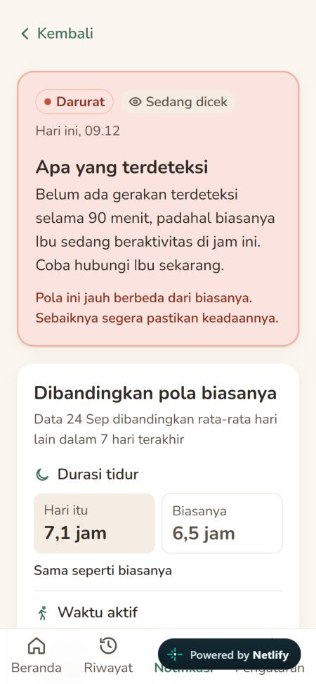
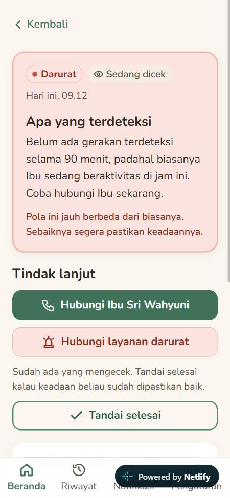

# TestSprite AI Testing Report(MCP)

---

## 1️⃣ Document Metadata
- **Project Name:** DEMO PROGRAM (NADI, prototipe interaktif FP HMI)
- **Date:** 2026-10-19
- **Prepared by:** TestSprite AI Team
- **Target:** build produksi (`npm run build` + `vite preview`, port 4173)
- **Diperbarui:** 2026-10-20, ditambah bagian 8 (uji ulang TestSprite dengan hardware sungguhan: 22/22 lulus). 2026-10-19, ditambah bagian 5–7 (tindak lanjut perbaikan, bukti sebelum–sesudah, uji tugas). Hasil tes di bagian 2–3 adalah run **sebelum** perbaikan.
- **Scope:** 21 dari 39 tes di rencana (duplikat Indonesia/Inggris dihapus; TC004 dilewati karena tidak bisa dicapai lewat UI, lihat Key Gaps #1)

---

## 2️⃣ Requirement Validation Summary

### Requirement: Dashboard (Beranda) & navigasi
- **Description:** Ringkasan status, tiga metrik harian, dan navigasi bawah antar tab.

#### Test TC002 See the main home summary on app open
- **Test Code:** [TC002_See_the_main_home_summary_on_app_open.py](./TC002_See_the_main_home_summary_on_app_open.py)
- **Test Error:** 
- **Test Visualization and Result:** https://www.testsprite.com/dashboard/mcp/tests/e4578d37-11a2-5087-9310-124ddf9ae89d/test/7639cdad-370f-4d4a-b4a5-6408b8d3f7d6
- **Status:** ✅ Passed
- **Severity:** LOW
- **Analysis / Findings:** Beranda menampilkan profil Ibu Sri Wahyuni, status Normal, tiga kartu metrik dengan perbandingan pola biasanya, dan aktivitas terakhir.
---

#### Test TC017 Berpindah antar tab utama aplikasi
- **Test Code:** [TC017_Berpindah_antar_tab_utama_aplikasi.py](./TC017_Berpindah_antar_tab_utama_aplikasi.py)
- **Test Error:** 
- **Test Visualization and Result:** https://www.testsprite.com/dashboard/mcp/tests/e4578d37-11a2-5087-9310-124ddf9ae89d/test/a24ad321-7756-4633-8274-ee1162c7ae96
- **Status:** ✅ Passed
- **Severity:** LOW
- **Analysis / Findings:** Keempat tab (Beranda, Riwayat, Notifikasi, Pengaturan) bisa dibuka lewat navigasi bawah.
---

### Requirement: Simulasi anomali & layar konfirmasi lansia
- **Description:** Fitur demo: layar HP lansia dengan satu pertanyaan, dua tombol, dan hitung mundur 20 detik.

#### Test TC008 Simulasikan anomali lalu konfirmasi kondisi lansia
- **Test Code:** [TC008_Simulasikan_anomali_lalu_konfirmasi_kondisi_lansia.py](./TC008_Simulasikan_anomali_lalu_konfirmasi_kondisi_lansia.py)
- **Test Error:** 
- **Test Visualization and Result:** https://www.testsprite.com/dashboard/mcp/tests/e4578d37-11a2-5087-9310-124ddf9ae89d/test/98c818d2-b7c0-4a27-b5eb-ca4d461451e8
- **Status:** ✅ Passed
- **Severity:** LOW
- **Analysis / Findings:** Jawaban "Ya, saya baik-baik saja" menampilkan ucapan terima kasih dan kembali ke app keluarga.
---

#### Test TC014 Membiarkan hitung mundur selesai pada layar konfirmasi lansia
- **Test Code:** [TC014_Membiarkan_hitung_mundur_selesai_pada_layar_konfirmasi_lansia.py](./TC014_Membiarkan_hitung_mundur_selesai_pada_layar_konfirmasi_lansia.py)
- **Test Error:** 
- **Test Visualization and Result:** https://www.testsprite.com/dashboard/mcp/tests/e4578d37-11a2-5087-9310-124ddf9ae89d/test/9d31f311-aced-43ce-9c19-58d6d2cd879c
- **Status:** ✅ Passed
- **Severity:** LOW
- **Analysis / Findings:** Saat hitung mundur habis, muncul "Keluarga sedang dihubungi." dan alert Darurat baru dibuat.
---

#### Test TC005 Menindaklanjuti alert baru dari dashboard
- **Test Code:** [TC005_Menindaklanjuti_alert_baru_dari_dashboard.py](./TC005_Menindaklanjuti_alert_baru_dari_dashboard.py)
- **Test Error:** 
- **Test Visualization and Result:** https://www.testsprite.com/dashboard/mcp/tests/e4578d37-11a2-5087-9310-124ddf9ae89d/test/8e149dee-68d7-4fda-b210-2c8b5ef8d695
- **Status:** ✅ Passed
- **Severity:** LOW
- **Analysis / Findings:** Setelah alert Darurat baru, kartu status Beranda berubah dan "Lihat & tindak lanjuti" membuka detail alert.
---

### Requirement: Notifikasi & detail alert
- **Description:** Daftar alert berkelompok, detail alert, dan tindak lanjut (panggilan simulasi, konfirmasi 112).

#### Test TC010 Open the notifications list and view alert grouping
- **Test Code:** [TC010_Open_the_notifications_list_and_view_alert_grouping.py](./TC010_Open_the_notifications_list_and_view_alert_grouping.py)
- **Test Error:** 
- **Test Visualization and Result:** https://www.testsprite.com/dashboard/mcp/tests/e4578d37-11a2-5087-9310-124ddf9ae89d/test/d95084ae-8778-44db-9f1f-f6e4bdf8ad33
- **Status:** ✅ Passed
- **Severity:** LOW
- **Analysis / Findings:** Alert dikelompokkan "Hari ini / Kemarin / Sebelumnya", terbaru di atas.
---

#### Test TC007 Open an alert from notifications
- **Test Code:** [TC007_Open_an_alert_from_notifications.py](./TC007_Open_an_alert_from_notifications.py)
- **Test Error:** 
- **Test Visualization and Result:** https://www.testsprite.com/dashboard/mcp/tests/e4578d37-11a2-5087-9310-124ddf9ae89d/test/a38fb9d0-6dbc-4374-8605-60f659b577e6
- **Status:** ✅ Passed
- **Severity:** LOW
- **Analysis / Findings:** Mengetuk item membuka detail alert yang sesuai; "Kembali" kembali ke daftar.
---

#### Test TC011 Tindak lanjuti alert baru dari notifikasi
- **Test Code:** [TC011_Tindak_lanjuti_alert_baru_dari_notifikasi.py](./TC011_Tindak_lanjuti_alert_baru_dari_notifikasi.py)
- **Test Error:** TEST FAILURE Alert “Darurat” tidak dapat ditandai sebagai sudah dicek dari halaman detail. Setelah kembali ke daftar, statusnya tetap “Sedang dicek.” Observations: - Halaman detail menampilkan “Notifikasi ini sudah ditanggapi” dan tidak menyediakan kontrol untuk menandai sudah dicek. - Di daftar Notifikasi, alert Darurat terbaru tetap berstatus “Sedang dicek.” - Tidak terlihat badge perubahan pada navigasi Notifikasi.
- **Test Visualization and Result:** https://www.testsprite.com/dashboard/mcp/tests/e4578d37-11a2-5087-9310-124ddf9ae89d/test/3a0b4bc7-5820-4ed1-a864-7e8f20db6584
- **Status:** ❌ Failed
- **Severity:** LOW
- **Analysis / Findings:** BUKAN bug aplikasi. Tes mengharapkan tombol "Tandai sudah dicek" pada alert Darurat. Sesuai desain, tombol itu hanya ada untuk alert Waspada berstatus Baru; alert Darurat hanya punya "Hubungi Ibu Sri Wahyuni" dan "Hubungi layanan darurat". Status "Sedang dicek" setelah menghubungi adalah perilaku yang benar. Lihat Key Gaps #1 dan #2 untuk celah desain terkait.
---

#### Test TC015 Start and end a simulated call to the family contact
- **Test Code:** [TC015_Start_and_end_a_simulated_call_to_the_family_contact.py](./TC015_Start_and_end_a_simulated_call_to_the_family_contact.py)
- **Test Error:** 
- **Test Visualization and Result:** https://www.testsprite.com/dashboard/mcp/tests/e4578d37-11a2-5087-9310-124ddf9ae89d/test/a69cf199-d58b-45f9-86a1-e24d5d9e2ca4
- **Status:** ✅ Passed
- **Severity:** LOW
- **Analysis / Findings:** Panggilan simulasi ke Ibu Sri terbuka ("Memanggil…") dan bisa diakhiri dengan "Akhiri panggilan".
---

#### Test TC016 Confirm or cancel an emergency call from alert detail
- **Test Code:** [TC016_Confirm_or_cancel_an_emergency_call_from_alert_detail.py](./TC016_Confirm_or_cancel_an_emergency_call_from_alert_detail.py)
- **Test Error:** 
- **Test Visualization and Result:** https://www.testsprite.com/dashboard/mcp/tests/e4578d37-11a2-5087-9310-124ddf9ae89d/test/3d46315c-ac60-489c-91c6-0372c74177e5
- **Status:** ✅ Passed
- **Severity:** LOW
- **Analysis / Findings:** Dialog "Hubungi layanan darurat (112)?" bisa dibatalkan atau dikonfirmasi (error prevention bekerja).
---

#### Test TC039 Menutup dialog konfirmasi dengan batal atau Escape
- **Test Code:** [TC039_Menutup_dialog_konfirmasi_dengan_batal_atau_Escape.py](./TC039_Menutup_dialog_konfirmasi_dengan_batal_atau_Escape.py)
- **Test Error:** 
- **Test Visualization and Result:** https://www.testsprite.com/dashboard/mcp/tests/e4578d37-11a2-5087-9310-124ddf9ae89d/test/c4de6c31-673c-49e9-b90a-a8a5f56b25b1
- **Status:** ✅ Passed
- **Severity:** LOW
- **Analysis / Findings:** Dialog konfirmasi tertutup dengan "Batal" maupun tombol Escape tanpa menjalankan aksi.
---

### Requirement: Riwayat 7 hari
- **Description:** Tab metrik (WAI-ARIA), grafik batang, tombol hari, dan kartu detail hari.

#### Test TC018 Meninjau riwayat 7 hari dan mengganti metrik
- **Test Code:** [TC018_Meninjau_riwayat_7_hari_dan_mengganti_metrik.py](./TC018_Meninjau_riwayat_7_hari_dan_mengganti_metrik.py)
- **Test Error:** 
- **Test Visualization and Result:** https://www.testsprite.com/dashboard/mcp/tests/e4578d37-11a2-5087-9310-124ddf9ae89d/test/77daed6a-4660-4f70-b72b-acf8c3f49c82
- **Status:** ✅ Passed
- **Severity:** LOW
- **Analysis / Findings:** Berganti metrik Durasi tidur / Waktu aktif / Bangun malam memperbarui grafik.
---

#### Test TC020 Inspect a different day in history
- **Test Code:** [TC020_Inspect_a_different_day_in_history.py](./TC020_Inspect_a_different_day_in_history.py)
- **Test Error:** 
- **Test Visualization and Result:** https://www.testsprite.com/dashboard/mcp/tests/e4578d37-11a2-5087-9310-124ddf9ae89d/test/a9165018-f8fd-4e15-ae5e-d85df5f0d3bd
- **Status:** ✅ Passed
- **Severity:** LOW
- **Analysis / Findings:** Memilih hari lain lewat tombol hari memperbarui kartu detail.
---

#### Test TC022 Buka detail hari yang berbeda jauh dari biasanya
- **Test Code:** [TC022_Buka_detail_hari_yang_berbeda_jauh_dari_biasanya.py](./TC022_Buka_detail_hari_yang_berbeda_jauh_dari_biasanya.py)
- **Test Error:** 
- **Test Visualization and Result:** https://www.testsprite.com/dashboard/mcp/tests/e4578d37-11a2-5087-9310-124ddf9ae89d/test/808d8f0d-43ac-45f1-8ef8-7197222741cf
- **Status:** ✅ Passed
- **Severity:** LOW
- **Analysis / Findings:** 22 September diberi penanda "Berbeda jauh dari biasanya" (tidak hanya warna).
---

#### Test TC024 Open an alert from a history day detail
- **Test Code:** [TC024_Open_an_alert_from_a_history_day_detail.py](./TC024_Open_an_alert_from_a_history_day_detail.py)
- **Test Error:** 
- **Test Visualization and Result:** https://www.testsprite.com/dashboard/mcp/tests/e4578d37-11a2-5087-9310-124ddf9ae89d/test/4ed28bdf-3efc-49dc-9aff-89cdaf813c84
- **Status:** ✅ Passed
- **Severity:** LOW
- **Analysis / Findings:** Alert di kartu "Catatan NADI di hari ini" bisa dibuka ke detail alert.
---

### Requirement: Pengaturan
- **Description:** Urutan kontak keluarga, jeda pemantauan, dan reset data demo.

#### Test TC028 Mengelola urutan kontak keluarga
- **Test Code:** [TC028_Mengelola_urutan_kontak_keluarga.py](./TC028_Mengelola_urutan_kontak_keluarga.py)
- **Test Error:** 
- **Test Visualization and Result:** https://www.testsprite.com/dashboard/mcp/tests/e4578d37-11a2-5087-9310-124ddf9ae89d/test/7651ac2d-c3a0-43b8-8eee-fc62bdb179b1
- **Status:** ✅ Passed
- **Severity:** LOW
- **Analysis / Findings:** Tombol naik/turun mengubah urutan prioritas kontak.
---

#### Test TC025 Menjeda pemantauan dan melihat status jeda di Beranda
- **Test Code:** [TC025_Menjeda_pemantauan_dan_melihat_status_jeda_di_Beranda.py](./TC025_Menjeda_pemantauan_dan_melihat_status_jeda_di_Beranda.py)
- **Test Error:** 
- **Test Visualization and Result:** https://www.testsprite.com/dashboard/mcp/tests/e4578d37-11a2-5087-9310-124ddf9ae89d/test/865b8620-47ca-460e-ba63-c6af123412f2
- **Status:** ✅ Passed
- **Severity:** LOW
- **Analysis / Findings:** Mengaktifkan "Jeda pemantauan" membuat Beranda menampilkan "Pemantauan dijeda".
---

#### Test TC035 Mereset data demo dan kembali ke state awal
- **Test Code:** [TC035_Mereset_data_demo_dan_kembali_ke_state_awal.py](./TC035_Mereset_data_demo_dan_kembali_ke_state_awal.py)
- **Test Error:** 
- **Test Visualization and Result:** https://www.testsprite.com/dashboard/mcp/tests/e4578d37-11a2-5087-9310-124ddf9ae89d/test/763e44a8-bc16-4763-afae-9f045322b13d
- **Status:** ✅ Passed
- **Severity:** LOW
- **Analysis / Findings:** "Reset data demo" mengembalikan state ke awal dan menampilkan pesan konfirmasi.
---

#### Test TC038 Reloading resets demo state to default
- **Test Code:** [TC038_Reloading_resets_demo_state_to_default.py](./TC038_Reloading_resets_demo_state_to_default.py)
- **Test Error:** TEST FAILURE The demo did not return to its initial state after the page was reloaded. Monitoring remained paused. Observations: - The “Jeda pemantauan” switch remained on after reload. - The page displayed “Pemantauan sedang dijeda.”
- **Test Visualization and Result:** https://www.testsprite.com/dashboard/mcp/tests/e4578d37-11a2-5087-9310-124ddf9ae89d/test/515719d1-ea45-4363-9fdf-40dc8380ac1a
- **Status:** ❌ Failed
- **Severity:** LOW
- **Analysis / Findings:** FALSE POSITIVE (skrip tes salah). Skrip yang dihasilkan menyalakan jeda lalu langsung memeriksa "setelah reload" tanpa pernah memanggil page.reload(). Diverifikasi manual di browser: setelah reload sungguhan, switch kembali mati dan Beranda menampilkan Normal.
---

### Requirement: Mode sensor langsung
- **Description:** Sumber data "Sensor langsung (ESP32)" tanpa penghubung Python berjalan.

#### Test TC029 Switch to live sensor mode and see the unavailable state
- **Test Code:** [TC029_Switch_to_live_sensor_mode_and_see_the_unavailable_state.py](./TC029_Switch_to_live_sensor_mode_and_see_the_unavailable_state.py)
- **Test Error:** TEST FAILURE The live sensor mode message is displayed on the Notifikasi page, but the expected sensor-unavailable state was not shown there. Observations: - The page says “Belum tersedia di mode sensor langsung.” - It says demo notifications are hidden so they are not mixed with sensor data. - “Penghubung sensor tidak terjangkau” was not visible on this page.
- **Test Visualization and Result:** https://www.testsprite.com/dashboard/mcp/tests/e4578d37-11a2-5087-9310-124ddf9ae89d/test/f1490d7f-692c-45d1-9c25-5babc16f5439
- **Status:** ❌ Failed
- **Severity:** LOW
- **Analysis / Findings:** BUKAN bug aplikasi. Tes mencari "Penghubung sensor tidak terjangkau" di halaman Notifikasi, padahal sesuai desain Notifikasi & Riwayat menampilkan "Belum tersedia di mode sensor langsung". Diverifikasi manual: Beranda menampilkan chip "Sensor langsung" dan "Penghubung sensor tidak terjangkau", tanpa status "Normal".
---

#### Test TC031 Kembali ke mode demo dari sensor langsung
- **Test Code:** [TC031_Kembali_ke_mode_demo_dari_sensor_langsung.py](./TC031_Kembali_ke_mode_demo_dari_sensor_langsung.py)
- **Test Error:** 
- **Test Visualization and Result:** https://www.testsprite.com/dashboard/mcp/tests/e4578d37-11a2-5087-9310-124ddf9ae89d/test/06a5ceb8-3931-45f3-94f9-822998303bc7
- **Status:** ✅ Passed
- **Severity:** LOW
- **Analysis / Findings:** "Beralih ke mode demo" mengembalikan alur demo.
---

## 3️⃣ Coverage & Matching Metrics

- **18 dari 21 tes lulus (86%)**. Ketiga kegagalan sudah diperiksa: **0 bug aplikasi**, 2 ekspektasi tes yang tidak sesuai desain, 1 skrip tes yang salah.

| Requirement | Total Tests | ✅ Passed | ❌ Failed |
|---|---|---|---|
| Dashboard (Beranda) & navigasi | 2 | 2 | 0 |
| Simulasi anomali & layar konfirmasi lansia | 3 | 3 | 0 |
| Notifikasi & detail alert | 6 | 5 | 1 |
| Riwayat 7 hari | 4 | 4 | 0 |
| Pengaturan | 4 | 3 | 1 |
| Mode sensor langsung | 2 | 1 | 1 |

---

## 4️⃣ Key Gaps / Risks

1. ✅ **Diperbaiki di `ad2272c`.** **"Tandai sudah dicek" tidak bisa dicapai di demo.** Tombol ini hanya muncul untuk alert Waspada berstatus Baru, tapi data awal tidak punya alert seperti itu dan simulasi anomali hanya membuat Info atau Darurat. Akibatnya fasilitator tidak bisa memperlihatkan alur ini saat uji pengguna (dan TC004 tidak bisa dijalankan). Pertimbangkan satu alert Waspada "baru" di data awal, atau pilihan simulasi Waspada.
2. ✅ **Diperbaiki di `ad2272c` dan `c933373`.** **Alert Darurat tidak bisa ditutup.** Setelah menghubungi, status berhenti di "Sedang dicek" dan tidak ada jalan ke "Selesai". TC011 tersandung di sini: penguji (seperti pengguna) mencari cara menandai alert sudah beres. Layak dicatat sebagai temuan Norman/Nielsen (visibilitas status, kontrol pengguna).
3. **Kualitas rencana tes otomatis.** Rencana awal berisi 39 tes dengan banyak duplikat, dan dua dari tiga kegagalan berasal dari asumsi tes yang keliru. Hasil gagal perlu selalu dicek manual sebelum dianggap bug.
4. ✅ **Sudah diuji manual (lihat bagian 5).** **Mode sensor langsung hanya teruji untuk keadaan "tidak terjangkau".** Keadaan kalibrasi, gerakan, diam, dan data basi butuh penghubung Python (`--replay`) dan tidak tercakup di sini.
5. ✅ **Sudah diuji manual di 375 px (lihat bagian 6–7).** **Tes dijalankan di viewport desktop.** Aplikasi mobile-first (acuan 390px); tata letak di lebar ponsel tidak diuji oleh TestSprite.

---

## 5️⃣ Tindak Lanjut: Temuan & Perbaikan

Sumber temuan: **TestSprite** (bagian 2–4), **Audit UI/UX** (heuristik Nielsen, WCAG 2.2, prinsip UX di AGENTS.md; situs publik dan build lokal diperiksa di 375 / 320 / 1366 px), dan **review lanjutan** setelah perbaikan pertama. Mode sensor langsung diuji manual dengan `sensor/csi_bridge.py --replay` memakai fixture sintetis. Semua keadaan muncul berurutan: tidak terjangkau → kalibrasi → membaca → diam → gerak → diam → data berhenti. Keadaan tanpa data tidak pernah tampil sebagai "diam" atau "Normal".

| # | Sumber | Temuan | Status | Commit |
|---|---|---|---|---|
| 1 | TestSprite (gap #1) | "Tandai sudah dicek" tidak bisa didemokan (tidak ada Waspada baru) | ✅ Diperbaiki: tombol demo "Simulasikan pola berubah" | `ad2272c` |
| 2 | TestSprite (gap #2, TC011) | Alert Darurat/Waspada tidak bisa ditutup, menggantung di "Sedang dicek" | ✅ Diperbaiki: tombol "Tandai selesai" | `ad2272c` |
| 3 | Audit #1 | Beranda "Normal · seperti biasanya" padahal Darurat 09.12 belum selesai dan 98 menit tanpa gerakan | ✅ Diperbaiki: kartu "Sedang dicek keluarga"; "Normal" hanya saat tidak ada alert terbuka | `c933373` |
| 4 | Review lanjutan | Darurat yang sedang dicek kalah dari Waspada baru; Info baru bisa menutupinya | ✅ Diperbaiki: dipilih alert paling serius dari gabungan Baru + Sedang dicek | `996771d` |
| 5 | Audit #3 | Tombol telepon terkubur (detail Darurat y=1099, 1,35 layar ke bawah); kartu Darurat tanpa tombol telepon | ✅ Diperbaiki: "Tindak lanjut" di atas perbandingan; "Hubungi Ibu Sri Wahyuni" langsung di kartu | `c933373` |
| 6 | Audit lokal A | "Tandai selesai" tidak terlihat efeknya di Beranda | ✅ Diperbaiki (ikut #3) | `c933373` |
| 7 | Review lanjutan | Fokus keyboard hilang setelah modal panggilan Beranda ditutup | ✅ Diperbaiki: fokus ke tombol tindak lanjut di kartu baru ("Lihat detail", bukan "Hubungi") | `996771d` |
| 8 | Review lanjutan | Kalimat "ada baiknya ditanyakan kabarnya" muncul dua kali di detail Waspada | ✅ Diperbaiki | `996771d` |
| 9 | Review lanjutan | Sumber data demo tidak jelas bagi orang yang baru membuka | ✅ Diperbaiki: chip "Demo · data contoh" dan tanggal cerita di baris pembaruan | `61b97c7` |
| 10 | Audit #6 (sebagian) | Mode sensor bisa tampil "Pemantauan sedang dijeda" padahal sensor tetap membaca | ✅ Diperbaiki: switch nonaktif dan diberi penjelasan di mode sensor | `61b97c7` |
| 11 | Audit #2 | Badge "Powered by Netlify" menutupi tab Notifikasi/Pengaturan, "Butuh bantuan", "Akhiri panggilan", dan "Kembali ke app keluarga" di 375 px | ⏳ Belum. Pengaturan proyek Netlify: *Project configuration → General → Powered by Netlify badge* | – |
| 12 | Audit #6 (sisa) | Jeda tanpa durasi/pengingat; switch ON berwarna hijau brand | ⏳ Belum | – |
| 13 | Audit #5 | Garis "pola biasanya" di grafik Riwayat berpindah saat memilih hari; detail hari di luar layar; sumbu Y tanpa satuan | ⏳ Belum | – |
| 14 | Audit #8 | "Terbangun malam" vs "Bangun malam" (satu hal, dua nama) | ⏳ Belum | – |
| 15 | Audit #4 | Eskalasi kontak ("Keluarga sedang dihubungi") tidak terlihat di sisi keluarga | ⏳ Belum | – |
| 16 | Audit #7 | Di Notifikasi, Darurat "Sedang dicek" terlihat sama dengan Info "Selesai" | ⏳ Belum | – |
| 17 | Audit #9 + lokal B | Mode sensor di situs publik selalu gagal (HTTPS → `http://…:8765`); copy sensor berisi jargon (port, hotspot 2,4 GHz) | ⏳ Belum | – |
| 18 | Audit #10 + lokal C/D | Identitas visual generik; tombol demo paling berat di Beranda; pill Waspada tanpa ikon | ⏳ Belum | – |

**Catatan untuk TestSprite:** beberapa ekspektasi tes sudah tidak berlaku, karena aplikasinya memang berubah, bukan karena ada bug. Contohnya TC002, yang mengharapkan Beranda dibuka dengan "Normal", padahal sekarang dibuka dengan "Sedang dicek keluarga". Rencana tes perlu diperbarui sebelum dijalankan ulang.

---

## 6️⃣ Bukti Sebelum–Sesudah (375 × 812 px)

| Alur | Sebelum | Sesudah |
|---|---|---|
| Status saat membuka Beranda | "✓ Normal · Pola keseharian terlihat seperti biasanya", padahal Darurat 09.12 masih "Sedang dicek" | "Sedang dicek keluarga" + badge Darurat + "Hari ini, 09.12"; chip "Demo · data contoh"; "Diperbarui 24 September 2026, 09.20" |
| Menelepon dari kartu Darurat | Hanya "Lihat & tindak lanjuti" → buka detail → scroll → "Hubungi" (2 ketukan + scroll) | "Hubungi Ibu Sri Wahyuni" langsung di kartu (1 ketukan) |
| Posisi tombol "Hubungi Ibu Sri Wahyuni" di detail Darurat | y = 1099 px (1,35 layar; perlu scroll) | y = 473 px (terlihat tanpa scroll) |
| Posisi "Tandai sudah dicek" di detail Waspada | y = 1127 px | y = 501 px |
| Menutup alert | Tidak bisa; status menggantung di "Sedang dicek" | "Tandai selesai" → Beranda kembali "Normal" bila tidak ada alert terbuka lain |
| Beberapa alert aktif (Darurat dicek + Waspada baru + Info) | Kartu menampilkan Waspada baru; Darurat yang belum selesai tersembunyi | Kartu tetap menampilkan Darurat (paling serius); badge Notifikasi tetap menghitung Waspada baru |

| Sebelum | Sesudah |
|---|---|
|  |  |
|  |  |
|  |  |

Gambar "sebelum" diambil dari situs publik sebelum perbaikan. Gambar "sesudah" diambil dari build lokal dan situs publik setelah perbaikan. Badge Netlify yang terlihat di beberapa gambar adalah temuan #11 yang belum diperbaiki.

**Verifikasi logika status:** 11 kombinasi alert diuji langsung pada `getCurrentStatus`, termasuk Darurat dicek + Waspada baru, Darurat dicek + Info baru, dua Darurat dicek, Info dicek, dan semua selesai. Semuanya lulus. Di browser, empat alert aktif sekaligus ditutup satu per satu dengan urutan yang benar (Darurat terbaru → Darurat 09.12 → Waspada → Normal).

---

## 7️⃣ Uji Tugas Singkat: memahami status → memilih tindakan → menyelesaikan alert

**Metode:** walkthrough tugas berskrip di situs publik (`index-D1-kjbJf.js`) pada 375 × 812 px. Setiap ketukan diarahkan ke titik tengah tombol di layar (`elementFromPoint`), jadi overlay seperti badge Netlify ikut terhitung sebagai penghalang. Ini **bukan** uji dengan partisipan. Pemahaman diukur dari apa yang terlihat tanpa scroll, bukan dari jawaban pengguna.

| Tugas | Status terlihat tanpa scroll | Aksi pertama terlihat tanpa scroll | Ketukan sampai selesai | Scroll | Penghalang | Hasil |
|---|---|---|---|---|---|---|
| A. Darurat sedang dicek (kondisi awal) | Ya: "Sedang dicek keluarga" | Ya: "Lihat & tindak lanjuti" | 3 | 0 | – | Selesai → "Normal" |
| B. Darurat baru (lansia menekan "Butuh bantuan") | Ya: "Butuh perhatian sekarang, segera hubungi" | Ya: "Hubungi Ibu Sri Wahyuni" | 5 (telepon, akhiri, tindak lanjut, selesai, kembali) | 0 | Badge Netlify menutupi "Akhiri panggilan" dan "Kembali ke app keluarga" | Selesai → "Normal" |
| C. Waspada baru (pola berubah) | Ya: "Ada pola yang berubah dari biasanya, perlu dicek" | Ya: "Lihat & tindak lanjuti" | 4 (tindak lanjut, sudah dicek, selesai, kembali) | 0 | – | Selesai → "Normal" |

Ukuran kartu status: 46–57% tinggi layar, berisi 32–46 kata. Kartu "Sedang dicek" paling padat (46 kata) karena memuat deskripsi alert ditambah petunjuk.

**Kesimpulan untuk penyederhanaan kartu:**
- **Penyederhanaan struktural tidak diperlukan saat ini.** Di ketiga tugas, status dan aksi utama sudah terlihat di layar pertama, dan tidak ada scroll sampai alert selesai.
- **Penyederhanaan terarah masih disarankan:**
  1. **Kartu "Sedang dicek" (46 kata):** pendekkan petunjuk, atau potong deskripsi jadi 2 baris. Kalimat "Coba hubungi Ibu sekarang" di deskripsi juga terasa janggal setelah keluarga menanggapi.
  2. **Waspada butuh dua keputusan** ("Tandai sudah dicek" lalu "Tandai selesai") untuk satu niat. Pertimbangkan satu langkah untuk Waspada.
- **Penghalang terbesar saat ini bukan kartu, tapi badge Netlify (#11).** Badge ini menutupi tombol di modal panggilan dan di layar lansia.
- **Langkah berikutnya:** uji tiga tugas yang sama dengan 3–5 partisipan (keluarga yang punya orang tua lansia). Catat keberhasilan, waktu, dan kesulitan (SEQ). Hasil itu yang menentukan apakah kartu perlu dipadatkan lebih jauh.

---

## 8️⃣ Uji Ulang TestSprite: setelah perbaikan, dengan hardware sungguhan (2026-10-20)

**Kondisi:** build produksi HEAD `21358cf` (`vite preview`, port 4173). ESP32-S3 tersambung lewat USB (COM23), dan `sensor/csi_bridge.py --port COM23` (dijalankan dengan venv `sensor/.venv`) melayani `http://localhost:8765/api/sensor/latest` dengan status `streaming` (sekitar 50–60 paket/detik, RSSI sekitar −52 dBm, kalibrasi selesai). Browser cloud TestSprite menjangkau port 4173 dan 8765 lewat tunnel. Log run tidak berisi satu pun "Target connect failed", jadi semua request ke bridge berhasil.

**Rencana tes:** dibuat ulang dari code summary yang sudah diperbarui (40 tes). Asersi TC003, TC013, dan TC018 dipertajam supaya menguji perilaku hasil perbaikan, bukan sekadar "kartu tampil". Ada dua tes baru: **TC039** (jeda nonaktif di mode sensor) dan **TC040** (beberapa alert aktif). Duplikat versi Indonesia/Inggris dibuang, sehingga yang dijalankan 22 tes.

**Hasil: 22/22 lulus.**

| Tes | Status | Hasil |
|---|---|---|
| **Beranda (mode demo) & navigasi** | | |
| [TC013 Melihat ringkasan dashboard demo saat pertama dibuka](./TC013_Melihat_ringkasan_dashboard_demo_saat_pertama_dibuka.py) | ✅ Lulus | [video & detail](https://www.testsprite.com/dashboard/mcp/tests/e4578d37-11a2-5087-9310-124ddf9ae89d/test/c911c1c4-673a-4359-a8a9-57081f83d4c3) |
| [TC026 Beralih ke setiap tab utama dari navigasi bawah](./TC026_Beralih_ke_setiap_tab_utama_dari_navigasi_bawah.py) | ✅ Lulus | [video & detail](https://www.testsprite.com/dashboard/mcp/tests/e4578d37-11a2-5087-9310-124ddf9ae89d/test/7e252b00-4f7f-4232-a090-5aa807df45e0) |
| [TC030 Badge notifikasi muncul setelah alert baru dibuat di mode demo](./TC030_Badge_notifikasi_muncul_setelah_alert_baru_dibuat_di_mode_demo.py) | ✅ Lulus | [video & detail](https://www.testsprite.com/dashboard/mcp/tests/e4578d37-11a2-5087-9310-124ddf9ae89d/test/7863a1ca-4f50-4175-bc87-377b53c6d2a0) |
| [TC040 Beberapa alert aktif: Darurat yang sedang dicek mengungguli Waspada baru](./TC040_Beberapa_alert_aktif_Darurat_yang_sedang_dicek_mengungguli_Waspada_baru.py) | ✅ Lulus | [video & detail](https://www.testsprite.com/dashboard/mcp/tests/e4578d37-11a2-5087-9310-124ddf9ae89d/test/cb34323d-77d4-4e0d-9dc0-622de20aecb0) |
| **Layar konfirmasi lansia** | | |
| [TC020 Konfirmasi baik-baik saja menambahkan alert info](./TC020_Konfirmasi_baik_baik_saja_menambahkan_alert_info.py) | ✅ Lulus | [video & detail](https://www.testsprite.com/dashboard/mcp/tests/e4578d37-11a2-5087-9310-124ddf9ae89d/test/8f5d638d-7acf-4653-8289-ce3b9f7aaed5) |
| [TC010 Konfirmasi butuh bantuan menambahkan alert darurat](./TC010_Konfirmasi_butuh_bantuan_menambahkan_alert_darurat.py) | ✅ Lulus | [video & detail](https://www.testsprite.com/dashboard/mcp/tests/e4578d37-11a2-5087-9310-124ddf9ae89d/test/24416251-b70d-4800-8ec9-58339b9e358e) |
| [TC027 Kedaluwarsa konfirmasi lansia otomatis menghubungi keluarga](./TC027_Kedaluwarsa_konfirmasi_lansia_otomatis_menghubungi_keluarga.py) | ✅ Lulus | [video & detail](https://www.testsprite.com/dashboard/mcp/tests/e4578d37-11a2-5087-9310-124ddf9ae89d/test/5f7c6347-86ce-4dfb-a88f-73b9f789b8a0) |
| **Detail alert & tindak lanjut** | | |
| [TC006 Alert darurat terbuka dapat dilihat detail dan ditindaklanjuti](./TC006_Alert_darurat_terbuka_dapat_dilihat_detail_dan_ditindaklanjuti.py) | ✅ Lulus | [video & detail](https://www.testsprite.com/dashboard/mcp/tests/e4578d37-11a2-5087-9310-124ddf9ae89d/test/d055d853-a20e-4f15-9bf2-52ec7bfb671c) |
| [TC009 Pengguna memeriksa detail alert dan menandainya selesai dari Notifikasi](./TC009_Pengguna_memeriksa_detail_alert_dan_menandainya_selesai_dari_Notifikasi.py) | ✅ Lulus | [video & detail](https://www.testsprite.com/dashboard/mcp/tests/e4578d37-11a2-5087-9310-124ddf9ae89d/test/1c48fa80-17fd-499c-bd9b-c2e88cd6e7ef) |
| [TC014 Menandai alert waspada sebagai sudah dicek lalu selesai](./TC014_Menandai_alert_waspada_sebagai_sudah_dicek_lalu_selesai.py) | ✅ Lulus | [video & detail](https://www.testsprite.com/dashboard/mcp/tests/e4578d37-11a2-5087-9310-124ddf9ae89d/test/a55af5e7-29c6-4f4e-8ca9-c9b9fa3e500e) |
| [TC019 Menghubungi keluarga dari alert darurat membuka modal panggilan simulasi](./TC019_Menghubungi_keluarga_dari_alert_darurat_membuka_modal_panggilan_simulasi.py) | ✅ Lulus | [video & detail](https://www.testsprite.com/dashboard/mcp/tests/e4578d37-11a2-5087-9310-124ddf9ae89d/test/2babd39b-bcb5-4631-b1f6-22dad62ebcb7) |
| [TC038 Membatalkan konfirmasi panggilan darurat](./TC038_Membatalkan_konfirmasi_panggilan_darurat.py) | ✅ Lulus | [video & detail](https://www.testsprite.com/dashboard/mcp/tests/e4578d37-11a2-5087-9310-124ddf9ae89d/test/e1b71cd0-010c-4f84-b957-64c2ccd29e5f) |
| **Riwayat** | | |
| [TC023 Meninjau riwayat tujuh hari dan berpindah metrik](./TC023_Meninjau_riwayat_tujuh_hari_dan_berpindah_metrik.py) | ✅ Lulus | [video & detail](https://www.testsprite.com/dashboard/mcp/tests/e4578d37-11a2-5087-9310-124ddf9ae89d/test/39fcd950-eec6-4799-9169-b207fb7b6b6b) |
| [TC024 Riwayat menampilkan metrik harian dan perbandingan saat tanggal dipilih](./TC024_Riwayat_menampilkan_metrik_harian_dan_perbandingan_saat_tanggal_dipilih.py) | ✅ Lulus | [video & detail](https://www.testsprite.com/dashboard/mcp/tests/e4578d37-11a2-5087-9310-124ddf9ae89d/test/7431c548-d481-49ee-83c7-b0b9835043d8) |
| **Pengaturan (mode demo)** | | |
| [TC032 Menjeda dan melanjutkan pemantauan di mode demo mengubah status beranda](./TC032_Menjeda_dan_melanjutkan_pemantauan_di_mode_demo_mengubah_status_beranda.py) | ✅ Lulus | [video & detail](https://www.testsprite.com/dashboard/mcp/tests/e4578d37-11a2-5087-9310-124ddf9ae89d/test/b26ef2e7-3bce-4d51-8539-e447ee02dd38) |
| [TC035 Mengatur ulang prioritas kontak keluarga](./TC035_Mengatur_ulang_prioritas_kontak_keluarga.py) | ✅ Lulus | [video & detail](https://www.testsprite.com/dashboard/mcp/tests/e4578d37-11a2-5087-9310-124ddf9ae89d/test/bf0ed1ee-c9c5-49d3-9834-eaa467e9fc0f) |
| [TC037 Mereset data demo ke kondisi awal](./TC037_Mereset_data_demo_ke_kondisi_awal.py) | ✅ Lulus | [video & detail](https://www.testsprite.com/dashboard/mcp/tests/e4578d37-11a2-5087-9310-124ddf9ae89d/test/24eb9c2b-9209-4dd0-86d8-a5d0ad03874e) |
| **Mode sensor langsung dengan ESP32-S3 sungguhan** | | |
| [TC003 Mengubah sumber data ke sensor langsung menampilkan pembacaan live di Beranda](./TC003_Mengubah_sumber_data_ke_sensor_langsung_menampilkan_pembacaan_live_di_Beranda.py) | ✅ Lulus | [video & detail](https://www.testsprite.com/dashboard/mcp/tests/e4578d37-11a2-5087-9310-124ddf9ae89d/test/7f2f21d6-cbe6-4fa3-bb17-d086c3e36a2f) |
| [TC018 Inspect live sensor technical details](./TC018_Inspect_live_sensor_technical_details.py) | ✅ Lulus | [video & detail](https://www.testsprite.com/dashboard/mcp/tests/e4578d37-11a2-5087-9310-124ddf9ae89d/test/76f2f3dd-9847-4f7c-a26b-33c8d9271f96) |
| [TC005 Switch to live sensor mode and return to the home dashboard](./TC005_Switch_to_live_sensor_mode_and_return_to_the_home_dashboard.py) | ✅ Lulus | [video & detail](https://www.testsprite.com/dashboard/mcp/tests/e4578d37-11a2-5087-9310-124ddf9ae89d/test/d23aaa71-c488-44bf-bd2c-05691ceba1b3) |
| [TC028 Melihat batasan mode sensor langsung pada Riwayat dan Notifikasi](./TC028_Melihat_batasan_mode_sensor_langsung_pada_Riwayat_dan_Notifikasi.py) | ✅ Lulus | [video & detail](https://www.testsprite.com/dashboard/mcp/tests/e4578d37-11a2-5087-9310-124ddf9ae89d/test/a000efac-32f8-4334-9a8b-8d571a2eebc3) |
| [TC039 Jeda pemantauan dinonaktifkan di mode sensor langsung](./TC039_Jeda_pemantauan_dinonaktifkan_di_mode_sensor_langsung.py) | ✅ Lulus | [video & detail](https://www.testsprite.com/dashboard/mcp/tests/e4578d37-11a2-5087-9310-124ddf9ae89d/test/52334879-67de-4563-80d2-1cdca08da7f4) |

**Yang dibuktikan oleh hardware sungguhan:**
- **TC003:** chip "Sensor langsung" tampil, kartu menampilkan keadaan live "Belum ada gerakan terdeteksi" (bukan "Penghubung sensor tidak terjangkau"), dan "Gerakan terakhir" serta "Data terakhir diterima" tampil.
- **TC018:** Detail teknis menunjukkan "COM23", "Perangkat (serial)", dan RSSI dalam dBm. Data ini hanya bisa muncul dari perangkat yang benar-benar tersambung.
- **TC039:** switch jeda `disabled` dan `aria-checked="false"` di mode sensor, dengan penjelasan "Jeda belum tersedia di mode sensor langsung. Pembacaan sensor tetap berjalan." Saat kembali ke demo, "Pemantauan sedang dijeda" muncul lagi.
- **TC028 / TC005:** Riwayat dan Notifikasi menampilkan "Belum tersedia di mode sensor langsung", dan bisa kembali ke mode demo.

**Yang dibuktikan di mode demo (hasil perbaikan):** TC013 (Beranda dibuka dengan "Sedang dicek keluarga" + badge Darurat, chip "Demo · data contoh", tanggal cerita), TC040 (beberapa alert aktif ditutup sesuai urutan sampai "Normal"), TC014 (Waspada: sudah dicek → selesai), TC009 (menandai selesai dari Notifikasi), dan TC019 (telepon dari kartu Darurat).

**Catatan jujur:**
- **TC040:** skrip Playwright yang diekspor hanya menyimpan asersi akhir (Beranda "Normal"). Urutan prioritas tetap teruji secara tidak langsung: tombol "Tandai selesai" di detail pertama hanya ada untuk alert yang "Sedang dicek" (Darurat), dan "Tandai sudah dicek" di detail kedua hanya ada untuk Waspada baru. Kalau urutannya salah, klik itu gagal. Aturan ini juga sudah diuji lewat 11 kasus logika (bagian 6).
- **Deteksi gerak bergantung pada orang yang bergerak** di dekat perangkat. Tes menerima keadaan "diam" maupun "gerak". Ketepatan deteksi gerak tidak diukur di sini (lihat `sensor/README.md` dan commit uji CSI-Bench).
- **Skrip run pertama (bagian 2) masih ada di folder ini.** Beberapa ID tes dipakai ulang dengan isi berbeda (misalnya TC018 dan TC039). Tabel di atas menautkan skrip run kedua.
- **Badge Netlify (temuan #11)** tidak tercakup, karena tes berjalan di build lokal. Badge ini masih perlu dimatikan di pengaturan proyek Netlify.
